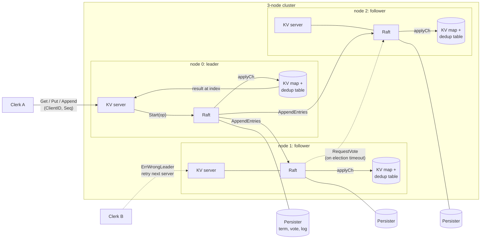

# raftkv

A linearizable, fault-tolerant key-value store built on a from-scratch Raft implementation in Go, tested under partitions, crashes, message loss and reordering, and checked with porcupine.

[](https://github.com/ranadhir-rikkala/raftkv/actions/workflows/ci.yml)

No consensus library is used: election, replication, commitment and
persistence are implemented in [`raft/`](raft/) directly from Figure 2 of the
[Raft paper](https://raft.github.io/raft.pdf). The only third-party dependency
is [porcupine](https://github.com/anishathalye/porcupine), used in tests.

## Architecture



1. A client `Clerk` sends an operation tagged with its `ClientID` and a
   per-client sequence number to the server it believes is leader.
2. The leader's KV server calls `Raft.Start`, which appends the op to the log
   and replicates it with `AppendEntries`.
3. Once a majority stores the entry, the leader commits it and every node
   delivers it on its apply channel, in log order, to its copy of the state
   machine.
4. The state machine checks the dedup table, executes the op at most once, and
   the leader replies to the client.

Raft talks through a `transport.Endpoint` interface with two implementations:
`memnet`, an in-process network that can drop, delay, partition and reorder
messages for tests, and `rpcnet`, which uses `net/rpc` over TCP for real nodes.
See [docs/DESIGN.md](docs/DESIGN.md) for the concurrency model, persistence and
dedup table design.

```
raft/               consensus: election, replication, commit, persistence
kv/                 replicated KV server, Clerk client, dedup table, porcupine tests
transport/          Endpoint interface
transport/memnet/   fault-injecting in-memory network (tests)
transport/rpcnet/   net/rpc over TCP (real cluster)
cmd/raftkv-server/  one cluster node
cmd/raftkv-cli/     command-line client
```

## Running a cluster

Requires Go 1.24+.

```sh
make cluster                 # builds ./bin and starts 3 nodes on :7001-:7003
./bin/raftkv-cli status
./bin/raftkv-cli put greeting hello
./bin/raftkv-cli append greeting ", world"
./bin/raftkv-cli get greeting            # hello, world

./scripts/cluster.sh kill 1              # SIGKILL a node (pick the leader from `status`)
./bin/raftkv-cli append greeting "!"     # a new leader takes over
make cluster                             # restarts the killed node; it recovers from .cluster/data
make cluster-stop                        # or `make cluster-clean` to also wipe state
```

Example session from my machine (leader killed with `kill -9`, then restarted):

```
$ ./bin/raftkv-cli status
node0 127.0.0.1:7001        term=1 role=follower applied=4 keys=1
node1 127.0.0.1:7002        term=1 role=leader applied=4 keys=1
node2 127.0.0.1:7003        term=1 role=follower applied=4 keys=1
$ ./scripts/cluster.sh kill 1
killed node1
$ time ./bin/raftkv-cli append greeting "!"
OK
... 0.748 total
$ ./bin/raftkv-cli status
node0 127.0.0.1:7001        term=3 role=follower applied=4 keys=1
node1 127.0.0.1:7002        unreachable (dial tcp 127.0.0.1:7002: connect: connection refused)
node2 127.0.0.1:7003        term=3 role=leader applied=5 keys=1
$ ./bin/raftkv-cli get greeting
hello, world!
```

With Docker:

```sh
docker compose up --build -d             # node0..node2, published on localhost:7001-7003
./bin/raftkv-cli status
docker compose stop node2                # stop a node, keep writing, then `docker compose start node2`
docker compose down -v
```

The CLI must be given every server (default: the three local ports). Servers
do not forward requests to the leader, so a client that only knows followers
cannot make progress.

## Testing strategy

All tests run with `go test -race`. Each test logs the `RAFTKV_SEED` it used;
setting it reruns the same fault schedule (timers still come from the real
runtime, so the harness is deterministic-ish, not deterministic).

**Fault injection (`transport/memnet`).** Tests run whole clusters in one
process over a simulated network that can:

- disconnect nodes, or split them into arbitrary partitions
- drop 10% of requests and 10% of replies and add 0 to 27 ms of delay
- hold most replies for 200 ms to 2.2 s so they arrive after newer ones
- crash a node and restart it from a copy of its persisted state, with a
  generation number that fences off traffic from the dead incarnation

**Raft tests (`raft/raft_test.go`).** Initial election, re-election after
leader failure, no leader without a quorum, many elections in a 7-node cluster,
agreement with failed followers and leaders, no commit without a majority,
concurrent `Start`s, partitioned-leader rejoin, fast log backtracking over
50-entry conflicts, persistence across full restarts and crash/partition mixes,
Figure 8 (crash the leader right after it appends), and Figure 8 on an
unreliable, reordering network. A checker on every apply channel fails the test
if two nodes ever apply different commands at the same index or apply out of
order.

**KV tests (`kv/`).**

- duplicate detection: the same `(ClientID, Seq)` Append sent three times is
  applied once
- concurrent appenders, on reliable and unreliable networks: every token
  appears exactly once and in client order
- minority partition cannot commit; majority keeps serving
- full-cluster restart rebuilds state and the dedup table by replaying the log
- a 3-node cluster over real TCP with file-backed persistence survives killing
  its leader

**Linearizability (`kv/linearizability_test.go`).** Eight concurrent clients
issue random Get/Put/Append operations on three keys against a 5-node cluster
while a nemesis injects faults. Every operation is recorded with invocation and
response times and the history is checked with porcupine against a sequential
key-value model. Three scenarios: no faults, random partitions, and random
partitions plus crash/restart on an unreliable network.
`TestCheckerCatchesStaleRead` checks that the model rejects a known-bad history.

To make sure the end-to-end check can catch real bugs, I temporarily changed
the server to answer `Get` from local state without going through Raft (a
stale-read bug). See the results below. Set `RAFTKV_DUMP=<dir>` to save any
history porcupine cannot decide in time.

## Results

Measured on an Apple Silicon MacBook (darwin/arm64), Go 1.27.4, all with
`-race`. These are the runs I actually did, not best-of.

**Full suite**, `go test -race -count=1 ./...`: all packages pass
(`raft` 100.2 s, `kv` 26.4 s).

**Repeated runs**, `-race -count=5`:

| Group | Tests | Runs | Passed | Wall time |
|---|---|---|---|---|
| Raft election, failure, partition, rejoin, backup, persistence | 11 | 55 | **55** | 337.8 s |
| Raft agreement, concurrent starts, Figure 8, Figure 8 unreliable | 5 | 25 | **25** | 146.2 s |
| KV (all tests, including porcupine and the TCP cluster) | 12 | 60 | **60** | 246.2 s |

`TestFigure8Unreliable` (500 rounds of leader crashes on a lossy, reordering
network) took 13.9 to 18.1 s per run. `TestInitialElection` never saw a term
change in a stable cluster across 6 runs.

**Porcupine.** In that first `-count=5` KV run the histories used 3 keys. 13 of
15 histories were proven linearizable within milliseconds, but **2 of 15 timed
out (Unknown after 60 s)**, one of them from the no-fault test. A timeout
proves nothing in either direction, so I spread the workload over 10 keys
(smaller per-key partitions, less concurrency per key) and reran the three
linearizability tests with `-count=5`: **15 of 15 Ok**, each check taking 5 ms or less,
on histories of 742 to 2,528 operations.

**Mutation check.** I temporarily changed the server to answer `Get` from local
state, without going through Raft, and ran the linearizability tests 3 times:

| Scenario | Caught the stale-read bug |
|---|---|
| Partitions + crashes on an unreliable network | **3 of 3** (Illegal, in about 3 ms) |
| Random partitions, reliable network | 0 of 3 |
| No faults | 0 of 3 |

Only the crash scenario catches the bug: it is the only one where a follower
falls far enough behind to serve a stale value to a client that just talked to
it. The other two scenarios still check the real system, but they are not
strong enough to catch this class of bug.

**Real cluster.** I ran `make cluster` and used the CLI against it. After
`kill -9` on the leader, the next `append` succeeded in 0.75 s end to end
(including the new election), and the restarted node rejoined from its state
file and caught up. The same flow works under `docker compose`
(`docker compose stop` on the leader container, write, `start` it again).

## Roadmap

- [x] **M1: Raft + linearizable KV.** Election, replication, persistence,
  dedup table, fault-injection harness, porcupine checking, real 3-node cluster
- [ ] **M2: Log compaction.** Snapshots of the KV map and dedup table,
  `InstallSnapshot` RPC, bounded persisted state
- [ ] **M3: Membership changes.** Joint consensus for adding and removing nodes
- [ ] **M4: Faster reads.** ReadIndex reads (with a leader no-op per term), then
  lease-based reads, with porcupine coverage for both
- [ ] **M5: Sharding.** A Raft-replicated shard controller, multiple replica
  groups, and shard migration between groups
- [ ] **M6: Operability.** Prometheus metrics (term changes, commit latency,
  apply lag), leader forwarding, client session expiry
- [ ] **M7: Fault scripts and benchmarks.** Jepsen-style nemesis scripts against
  the Docker cluster (partitions with iptables, process pauses, clock skew), and
  a throughput/latency benchmark of batching and pipelining AppendEntries

## What I learned

- **Stale messages are the normal case, not the edge case.** Most of the
  subtle code in `raft.go` decides what to do with a reply that comes back
  after the world has changed: drop it if the term or role changed, never
  let it move `matchIndex` backwards, and only rewind `nextIndex` if it still
  holds the value the request was built from. On the follower side, a
  reordered AppendEntries carrying an old `LeaderCommit` would have *lowered*
  `commitIndex` if I had assigned `min(leaderCommit, lastNew)` directly
  instead of only ever raising it.
- **A test can hang for a reason that has nothing to do with the system
  under test.** My first minority-partition test gave the client only the
  minority servers. After the partition healed those servers were followers,
  and since servers don't forward to the leader, the client retried forever.
  Raft was fine; my mental model of the client was not. That is also why the
  CLI needs the full server list (leader forwarding is on the roadmap).
- **A green linearizability check is only as strong as its nemesis.** Without
  the mutation experiment I would have assumed the partition test protects
  reads. It doesn't. Crashes plus message loss do. A checker run with no
  injected failure that it should catch doesn't tell me much.
- **"Unknown" is not "Ok".** Porcupine's search is exponential in the worst
  case. With too few keys, a correct history occasionally took longer than 60 s
  to decide. Reshaping the workload (more keys, so smaller and less concurrent
  partitions) turned that into milliseconds, without weakening the stale-read
  detection.
- **Fencing dead incarnations matters in tests too.** Restarting a node in the
  harness while its old goroutines could still send RPCs would let a "crashed"
  node keep influencing the cluster. Generation numbers on the simulated
  network fence those messages off, the same way a real system relies on
  terms and connection teardown.
- **Lost wakeups hide in "start, then register".** The KV server registers its
  waiter for a log index while still holding the lock it took before calling
  `Raft.Start`. Otherwise the entry can be applied before anyone is waiting,
  and the client times out on an operation that already succeeded.

## License

MIT, see [LICENSE](LICENSE).
